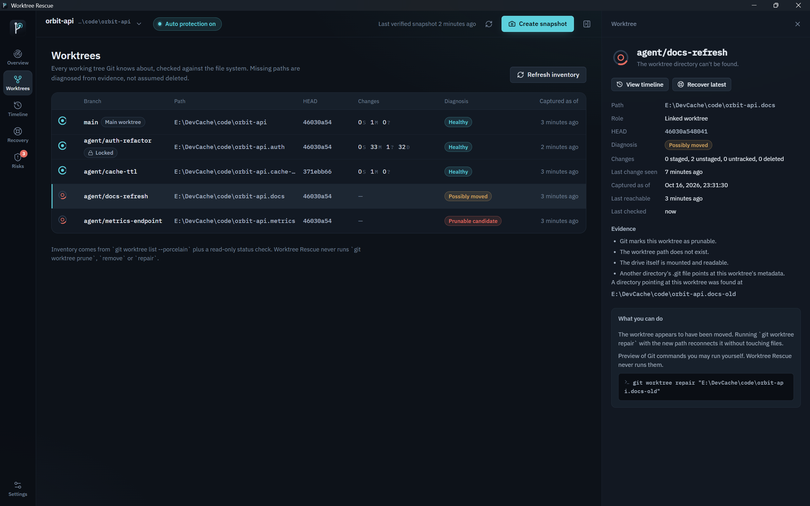

<div align="center">


# Worktree Rescue

**The black box for AI-assisted development.**
Your agents build. We preserve.

[](https://github.com/ChefDavid0815/worktree-rescue/actions/workflows/ci.yml)
[](https://github.com/ChefDavid0815/worktree-rescue/releases)


[Download for Windows](https://github.com/ChefDavid0815/worktree-rescue/releases/latest) ·
[中文说明](README.zh-CN.md) ·
[Changelog](CHANGELOG.md) ·
[Security model](SECURITY.md)

</div>


When Claude Code, Codex and other agents work in parallel Git worktrees,
uncommitted work lives in places Git does not protect: a worktree directory a
cleanup script removes, a folder someone moves, files an agent overwrites
before anyone committed. Git keeps history. **Worktree Rescue keeps
everything that never made it into history** — as independent, hash-verified
snapshots in a local vault — and gets it back without touching your
repository.

## What it does

| | |
|---|---|
| **Worktree inventory** | Reads `git worktree list` for every registered repository and checks each path against the file system. A missing directory is *diagnosed*, not assumed deleted: missing, possibly moved (another folder's `.git` points here), prunable, drive unavailable, inaccessible. Locks, detached HEADs and unborn branches are shown as they are. |
| **Independent snapshots** | Captures staged content, working-tree bytes, untracked files, deletions and renames of a worktree into a content-addressed SHA-256 vault, with an atomic JSON manifest per snapshot. A snapshot is *verified* only after newly written content is re-hashed and the manifest and database are committed. |
| **Automatic protection** | Opt-in per repository. Watches the worktrees, waits for edits to settle (20 s), snapshots at most once a minute, and takes checkpoints every 10 minutes during long sessions. Unchanged states are confirmed, not duplicated. |
| **Recorder & timeline** | A per-worktree time strip of every snapshot, branch switch, HEAD move, exposure window and disappearance, plus a filterable timeline with file-path search. |
| **Diff viewer** | Compare HEAD → snapshot, snapshot → current file, or staged → working tree, and step through every captured version of a file. |
| **Safe recovery** | Recover into a **new folder** by default; every file is re-hashed after writing and a report is saved next to it. In-place restore is available for up to 200 files, after a server-side preview, a verified protection snapshot of what will be replaced, and your explicit confirmation. The Git index is never rebuilt. |
| **Git history search** | Read-only reflog, stash and `git fsck --unreachable` discovery. Every candidate keeps its provenance label and is never presented as a snapshot. |
| **Risk Observatory** | Local rules raise findings with severity, confidence and raw evidence: unreachable worktrees with uncaptured work, changes not snapshotted for a while, failing automatic snapshots, mass deletions, low disk space, budget pressure, files left out by policy, integrity failures. Risks inform; they never block Git or your agents. |

<table>
<tr>
<td width="50%"></td>
<td width="50%"></td>
</tr>
<tr>
<td></td>
<td></td>
</tr>
</table>

## A typical rescue

1. Four agents work in `orbit-api.cache-ttl`, `.metrics`, `.docs` and `.auth`
   while automatic protection snapshots each worktree as edits settle.
2. A cleanup script runs `rm -rf` on `orbit-api.metrics` seconds after the
   agent's last edit. The next inventory pass reports the worktree as a
   **prunable candidate** with the evidence (`path not found`, `drive mounted`,
   `Git marks it prunable`) and raises a **critical** risk because changes were
   observed after its last snapshot.
3. You open the risk, choose **Recover from snapshot**, keep the default
   *separate folder*, and get every captured file back under
   `Documents\Worktree Rescue\Recovered\…\working-tree\`, each one re-hashed,
   with `RECOVERY-README.md` explaining what was and wasn't recoverable.
4. The work that happened in the final seconds before the deletion is reported
   as exactly that: changes Worktree Rescue observed but never captured.

## Install

1. Download `Worktree Rescue_1.0.0_x64-setup.exe` from the
   [latest release](https://github.com/ChefDavid0815/worktree-rescue/releases/latest).
2. Run it. It installs for the current user and needs no administrator rights.
   The build is not code-signed yet, so SmartScreen may ask you to confirm
   (*More info → Run anyway*). Compare the SHA-256 in the release notes if you
   want to verify the download.

**Requirements:** Windows 10 21H2 or Windows 11 (x64), Microsoft Edge WebView2
(preinstalled on Windows 11), Git 2.31 or newer on `PATH`.

## Use

1. **First launch** checks Git, the vault folder and free space, then asks for
   a repository. Any folder inside it works, including a linked worktree;
   the whole repository and all its worktrees are registered.
2. **Choose automatic protection** per repository, or create snapshots
   manually with **Create snapshot** (`Ctrl+Shift+S`).
3. **Not sure yet?** Choose *Explore the sandbox demo*: it builds a throwaway
   repository with three agent worktrees in a separate vault, deletes one and
   moves another, so you can practise recovery without risk.
4. Keyboard: `Ctrl+1…6` switches between Overview, Worktrees, Timeline,
   Recovery, Risks and Settings.

The interface is available in **English** and **简体中文** (Settings →
Appearance & language), in dark and light themes.

## What is (and isn't) protected

| Captured | Not captured unless you change the settings |
|---|---|
| Modified, deleted and renamed tracked files (up to 25 MB each) | Git-ignored files — add include rules such as `notes/**` |
| Staged content, separately from the working tree | Dependency and build caches (`node_modules`, `target`, `dist`, …) |
| New untracked files | Sensitive files (`.env`, `*.pem`, SSH keys) |
| Symbolic links as link text (never followed) | Files over the size limit or beyond the repository budget |

Support levels: linked worktrees, detached HEAD and repositories without
commits are **supported**; submodules (pointer recorded, contents not
captured), sparse checkouts (only materialised files) and Git LFS (working-tree
bytes as they are on disk) are **partial**; bare repositories are
**unsupported** because they have no working tree.

> **The limit:** Worktree Rescue can only return what it captured or what Git
> still has. Work that was never committed, never snapshotted and is gone from
> disk cannot be recovered by any tool.

## Safety guarantees

- **Repositories are only read.** Git runs through an allow-list of read-only
  sub-commands with `GIT_OPTIONAL_LOCKS=0`, argument vectors (no shell),
  timeouts and cancellation. `reset --hard`, `clean`, `stash push`,
  `worktree remove/prune/repair` and similar are rejected by a unit-tested
  guard; repair commands are only *shown* as guidance.
- **A test proves it:** the integration suite fingerprints working-tree files,
  the index, `HEAD`, refs, reflogs and the stash list before and after
  inventory, snapshots, deep verification, forensic scans, restore previews,
  retention and recovery — they must be byte-identical.
- **Writes are bounded** to the vault (`%LOCALAPPDATA%\WorktreeRescue`) and to
  recovery folders you pick; recovery targets inside any worktree, Git
  directory or the vault are refused.
- **Untrusted paths are validated** (traversal, absolute paths, Windows device
  names, alternate data streams, case collisions) and links/junctions are never
  followed.
- **Private by design:** no network access, no telemetry, no account, no
  upload. Diagnostics exports contain metadata only and are saved where you
  choose.

## How it works

```
crates/wr-core         Rust core — no UI dependency
  git.rs               read-only Git runner, porcelain v2 / worktree / cat-file parsers
  worktree.rs          inventory and evidence-based diagnosis
  snapshot.rs          capture engine (bounded parallelism, stability checks)
  blob.rs manifest.rs  content-addressed store, atomic manifests
  store.rs             SQLite schema, migrations, queries
  recovery.rs          six-phase recovery, previews, atomic restore
  forensics.rs         reflog / stash / unreachable-object discovery
  risk.rs retention.rs rule engine, retention planning
src-tauri              Tauri 2 shell: typed commands, watcher, scheduler
src                    React + TypeScript UI, feature folders, design tokens
```

Design decisions are recorded in [`docs/adr`](docs/adr).

## Build from source

```bash
git clone https://github.com/ChefDavid0815/worktree-rescue
cd worktree-rescue
npm install
npm run app:dev            # run with hot reload
cargo test -p wr-core      # 49 Rust tests against real temporary repositories
npm test                   # UI tests
npx tauri build            # NSIS installer in target/release/bundle/nsis
```

See [CONTRIBUTING.md](CONTRIBUTING.md) for toolchain notes (MSVC or MinGW-w64).

## License

[MIT](LICENSE)
