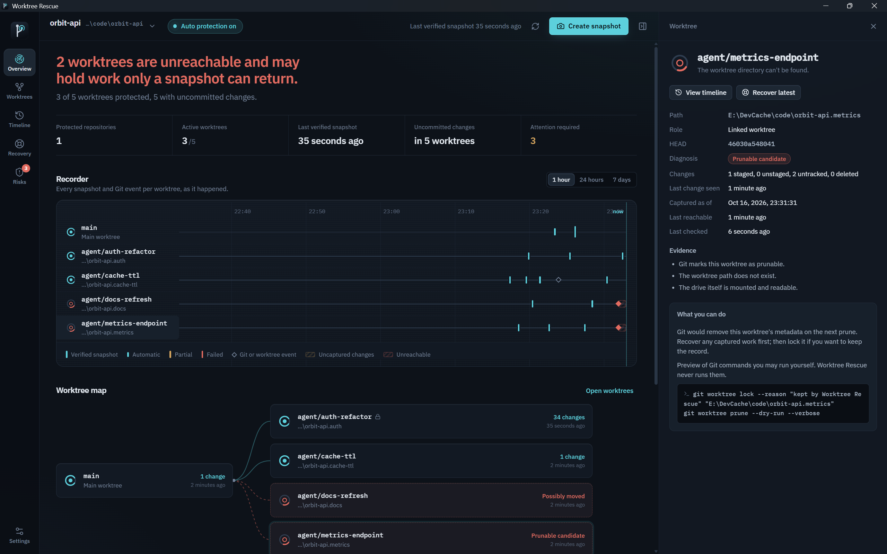

<div align="center">


# Worktree Rescue

**AI 辅助开发的“黑匣子”。**
代理负责构建，我们负责保全。

[下载 Windows 版](https://github.com/ChefDavid0815/worktree-rescue/releases/latest) ·
[English](README.md) ·
[更新日志](CHANGELOG.md) ·
[安全模型](SECURITY.md)

</div>



当 Claude Code、Codex 等代理在多个 Git 工作树中并行工作时，大量未提交的工作处在 Git
保护不到的地方：被清理脚本删掉的工作树目录、被人手动挪走的文件夹、在任何人提交之前就被代理覆盖的文件。
Git 保存历史；**Worktree Rescue 保存那些从未进入历史的内容**——以独立、经过哈希校验的快照存放在本地保险库中，并且在找回时不触碰你的仓库。

## 功能

| | |
|---|---|
| **工作树清单** | 读取每个仓库的 `git worktree list`，并逐个与文件系统核对。目录缺失时依据证据进行*诊断*，而不是直接认定已删除：缺失、可能已移动（另一个目录的 `.git` 指向这里）、可被清理、驱动器不可用、无法访问。锁定、游离 HEAD、尚无提交的分支都如实显示。 |
| **独立快照** | 把工作树的暂存内容、工作区字节、未追踪文件、删除与重命名捕获到按 SHA-256 内容寻址的保险库，每个快照对应一份原子写入的 JSON 清单。只有在新写入内容重新校验哈希、清单与数据库都提交之后，快照才会被标记为*已验证*。 |
| **自动保护** | 按仓库选择开启。监视工作树，等待编辑稳定（20 秒）后快照，同一工作树每分钟最多一次，长时间连续编辑时每 10 分钟建立检查点；内容未变时只做确认，不重复存储。 |
| **记录仪与时间线** | 每个工作树一条时间带，标出每一次快照、分支切换、HEAD 移动、暴露窗口与失联；配合可筛选、可按文件路径搜索的时间线。 |
| **差异查看** | 对比 HEAD → 快照、快照 → 当前文件、暂存 → 工作区，并可逐个浏览文件的所有已捕获版本。 |
| **安全恢复** | 默认恢复到**新的独立文件夹**，写入后逐个文件重新校验哈希，并在旁边生成报告。也可就地还原最多 200 个文件：需经过服务端预览、对将被替换内容的已验证保护快照，以及你的明确确认。从不重建 Git 索引。 |
| **Git 历史检索** | 只读检索 reflog、stash 与 `git fsck --unreachable`。每个候选项都带有来源标签，绝不会被当作快照呈现。 |
| **风险观测** | 本地规则给出带严重程度、置信度和原始证据的发现：有未捕获工作的不可访问工作树、长时间未快照的改动、持续失败的自动快照、批量删除、磁盘空间不足、预算压力、被策略排除的文件、完整性失败。风险只做提示，从不阻止 Git 或你的代理。 |

## 安装

1. 从 [最新版本](https://github.com/ChefDavid0815/worktree-rescue/releases/latest) 下载 `WorktreeRescue_1.0.0_x64-setup.exe`。
2. 运行安装程序。它为当前用户安装，无需管理员权限。此版本尚未代码签名，SmartScreen 可能会要求确认（“更多信息 → 仍要运行”）。

**系统要求：** Windows 10 21H2 或 Windows 11（x64）、Microsoft Edge WebView2（Windows 11 已预装）、`PATH` 中有 Git 2.31 或更新版本。

## 使用

1. **首次启动**会检查 Git、保险库文件夹与可用空间，然后请你选择仓库。仓库中的任意文件夹（包括链接工作树）都可以，整个仓库及其所有工作树都会被登记。
2. 按仓库**选择是否开启自动保护**，或用“创建快照”（`Ctrl+Shift+S`）手动创建。
3. **想先试试？** 选择“体验沙盒演示”：它会在独立的保险库中生成一个临时仓库和三个代理工作树，随后删除一个、移动另一个，让你无风险地练习恢复。
4. 快捷键：`Ctrl+1…6` 在概览、工作树、时间线、恢复、风险、设置之间切换。

界面支持 **English** 与 **简体中文**（设置 → 外观与语言），并提供深色与浅色主题。

## 保护范围

| 会被捕获 | 默认不捕获（可在设置中调整） |
|---|---|
| 已追踪文件的修改、删除与重命名（单个最大 25 MB） | 被 Git 忽略的文件——可添加 `notes/**` 之类的纳入规则 |
| 暂存内容，与工作区分开保存 | 依赖与构建缓存（`node_modules`、`target`、`dist` 等） |
| 新增的未追踪文件 | 敏感文件（`.env`、`*.pem`、SSH 密钥） |
| 符号链接（只记录链接文本，从不跟随） | 超过大小上限或超出仓库预算的文件 |

> **能力边界：** Worktree Rescue 只能找回它捕获过的内容，或 Git 仍然保留的内容。从未提交、从未被快照且已从磁盘消失的工作，任何工具都无法恢复。

## 安全保证

- **仓库只读。** Git 通过只读子命令白名单执行，并设置 `GIT_OPTIONAL_LOCKS=0`，使用参数数组（不经过 shell），带超时与取消。`reset --hard`、`clean`、`stash push`、`worktree remove/prune/repair` 等都会被经过单元测试的守卫拒绝；修复命令只作为指引*展示*。
- **有测试证明：** 集成测试会在清单检查、快照、深度校验、取证扫描、还原预览、保留策略与恢复前后，对工作区文件、索引、`HEAD`、引用、reflog 与 stash 列表做指纹比对，要求逐字节一致。
- **写入受限**于保险库（`%LOCALAPPDATA%\WorktreeRescue`）以及你选择的恢复文件夹；位于任何工作树、Git 目录或保险库内的恢复目标都会被拒绝。
- **隐私优先：** 不联网、无遥测、无需账号、不上传任何内容。诊断导出只包含元数据，由你决定保存位置。

## 从源码构建

```bash
git clone https://github.com/ChefDavid0815/worktree-rescue
cd worktree-rescue
npm install
npm run app:dev
cargo test -p wr-core
npm test
npx tauri build
```

## 许可证

[MIT](LICENSE)
